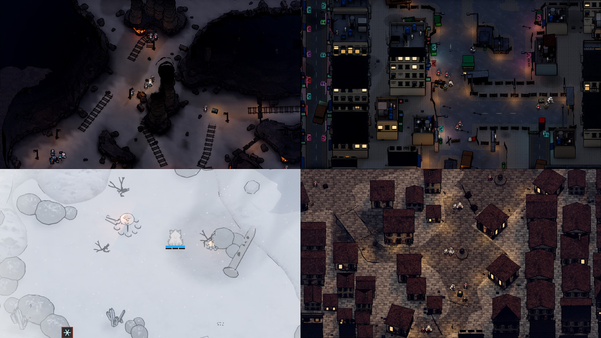
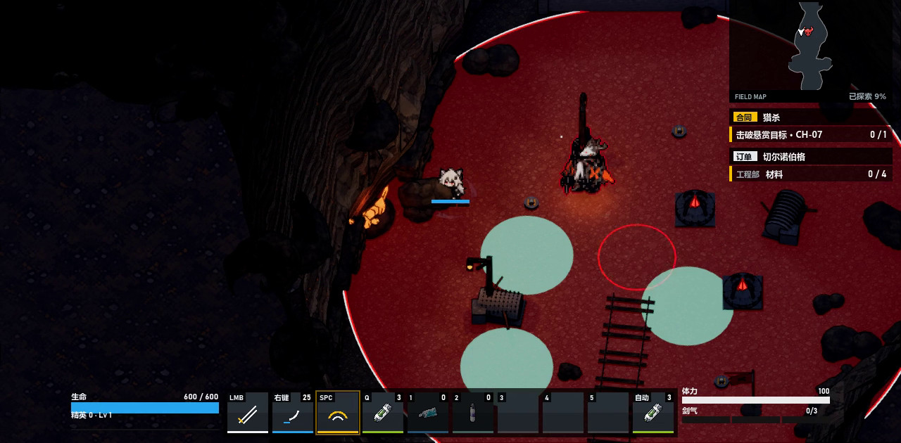
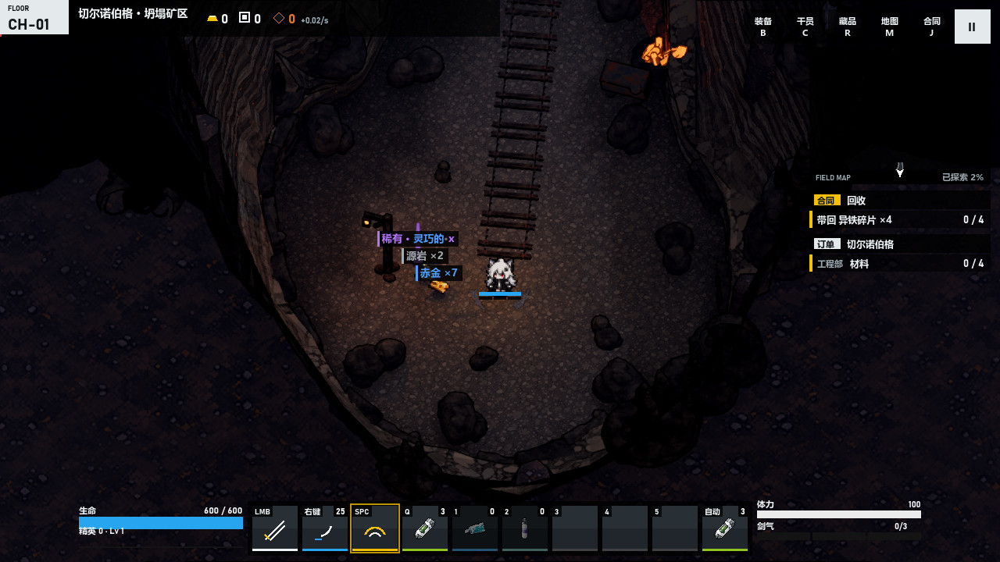
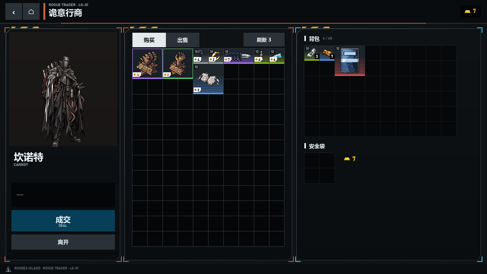
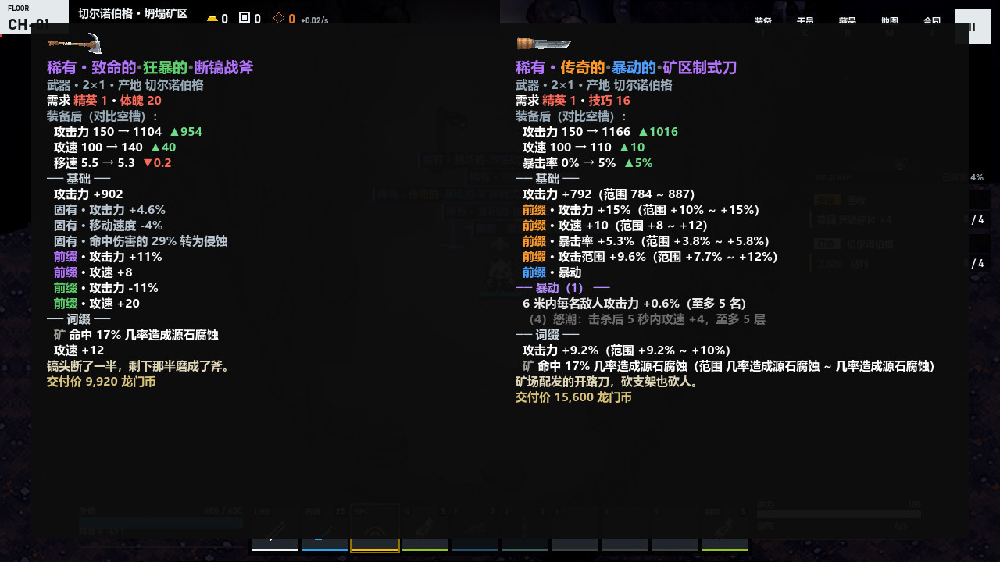
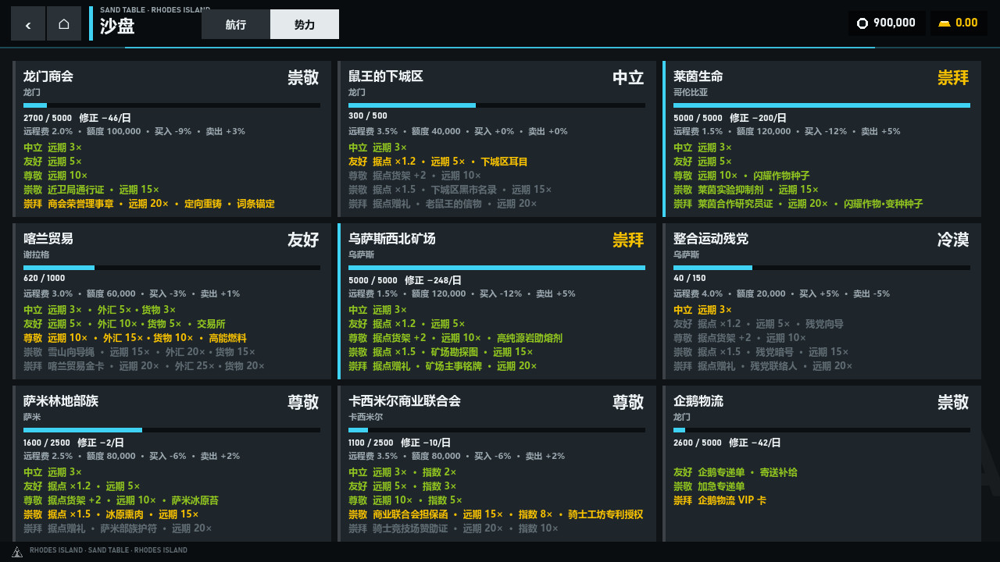
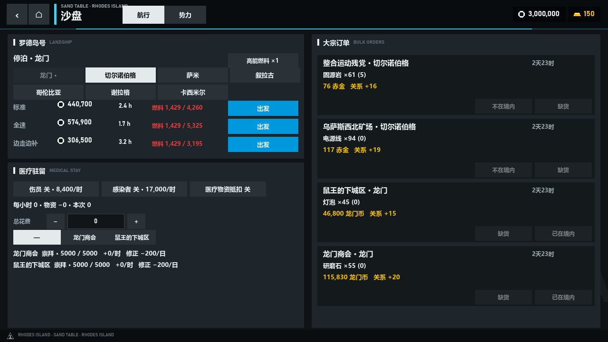
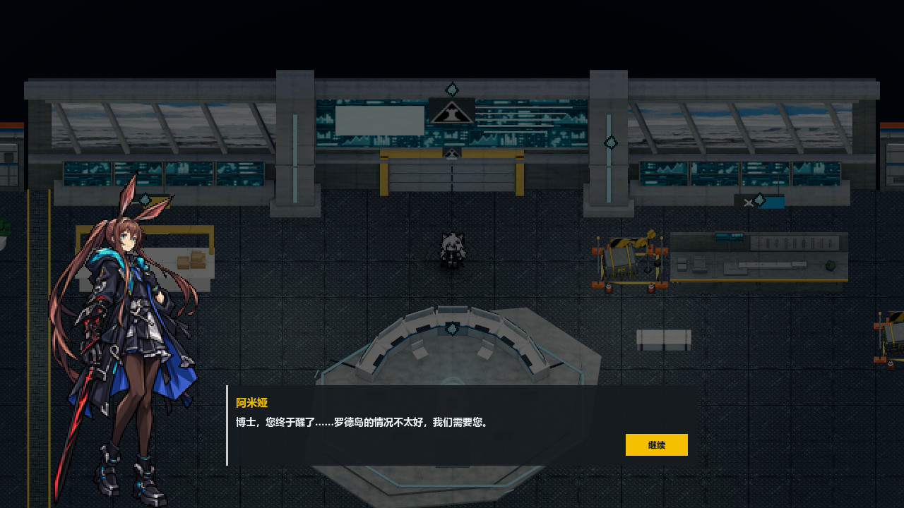

# 罗德岛日常 / Rhodes Daily

单人 PC 游戏，俯视角即时战斗的刷宝撤离 ARPG，外加罗德岛基地经营。明日方舟同人作品，Godot 4.7 制作，中英双语。

玩家扮演博士。在基地接合同、整备，然后带干员下到外勤区域，一层层往下打，攒够了就撤离。撤离成功，背包里的东西都带回来；死在里面，没投保的东西全丢。带回来的东西拿去卖、加工、交易，用来扩建罗德岛。

---

## 外勤

### 地区

四个地区：切尔诺伯格矿区、龙门城区、萨米雪原、叙拉古旧城。各有自己的地形、敌人、天气和装备，部分地区有污染、寒冷、血债等特殊机制。地图里有密室、陷阱和踪迹。

### 路线图

肉鸽式路线图，每层选一条路，途中有战斗、商人、事件、撤离点和营地。

### Boss

每个地区一个 Boss：爱国者、“鼠王”、“木裂”埃克提尔尼尔、扎罗“狼之主”，另有守卫者。

### 战斗

即时战斗，靠走位和读招。敌人出招有预警，伤害分物理、法术和元素。在一层待久了威胁值会上涨。

### 局内

局内有藏品、药剂、随机出现的行商坎诺特，可以中途存档。

---

## 干员

九名可出战干员：阿米娅、拉普兰德、赫拉格、早露、星熊、林、提丰、寒檀、德克萨斯。通过寻访或在外勤中找回失散干员获得，有精英化、技能树和独立装备。

---

## 装备

多部位装备、地区专属款式、多档稀有度、随机前缀和 Boss 套装。整备台可以重铸前缀。出发前可以给装备投保。

---

## 罗德岛

可以走动的基地，有调度台、整备台、仓库、医疗部、药房、商店、加工站、人事部、科研部、基建、沙盘、交易所等站点。

### 势力与交易所

九家势力，各有行情和声望。交易所有现货、远期、外汇和证券。

### 沙盘航行

驾驶罗德岛在泰拉航行，接订单和运送合同，开放新地区。

### 主线

基地有一条主线剧情。

---

## 运行

Godot 4.7.2，Forward+，Windows 下用 D3D12。用 Godot 打开 `project.godot`，运行 `game/main.tscn`。

---

## 版权

非商业同人作品。明日方舟、罗德岛、PRTS 以及其中的角色、势力、地区归鹰角网络（Hypergryph）所有。
