# 罗德岛日常 / Rhodes Daily

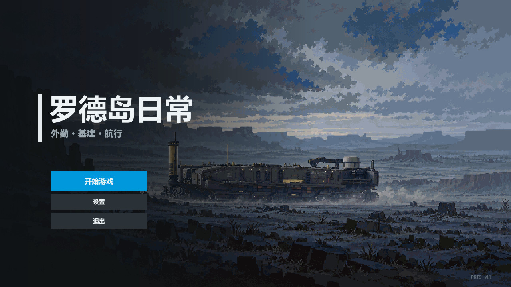

单人 PC 游戏，俯视角即时战斗的刷宝撤离 ARPG，外加罗德岛基地经营。明日方舟同人作品，Godot 4.7 制作，中英双语。

玩家扮演博士。在基地接合同、整备，然后带干员下到外勤区域，一层层往下打，攒够了就撤离。撤离成功，背包里的东西都带回来；死在里面，没投保的东西全丢。带回来的东西拿去卖、加工、交易，用来扩建罗德岛。

---

## 外勤

### 地区

| 地区 | 环境 | 玩法特色 |
|---|---|---|
| 切尔诺伯格矿区 | 矿洞、坑道、源石矿脉 | 源石污染随停留时间累积，越深越危险 |
| 龙门城区 | 上城与下城街区，昼夜随机 | 路障封街，霓虹巷道，鼠王的地盘 |
| 萨米雪原 | 林地、岩台、冰封石桥 | 寒冷会持续积累，要靠火堆取暖，严重时会遇上暴风雪 |
| 叙拉古旧城 | 黄昏与雨夜的旧城区 | 血债：杀得越多，家族派来的杀手越多越狠 |

每个地区有自己的敌人阵容、天气、光照和地区装备。敌人来自原作的对应阵营，多种攻击方式。

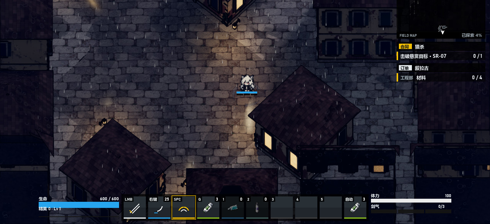

### 地图里有什么

- **密室**：藏在墙后，墙脚有线索，打开后有守卫和宝箱。
- **陷阱**：踩中会受伤、被控制，还会让威胁值上涨。
- **踪迹**：失散干员留下的痕迹，顺着找可以把人带回罗德岛。
- **兴趣点**：可以搜刮的物资堆、设备和尸体。
- **增益装置**：从几件藏品里挑一件。
- **悬赏目标**：合同要猎杀的精英敌人。
- **小地图**：显示已探索区域、出口和战斗缴获。

### 路线图

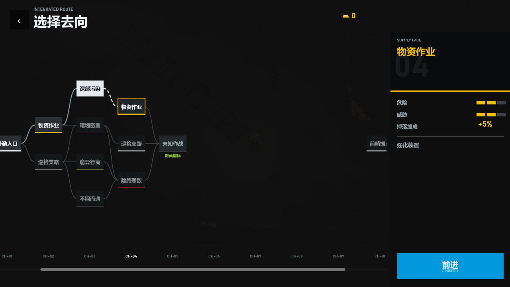

外勤按肉鸽路线图推进，每一段是一张分叉的路线，只能看清下一步，再往后是模糊的。每层出口都要选下一层走哪条路。

### 守卫者与 Boss

固定深度有守卫者把关。每个地区还有一位 Boss，会在更深处一次次出现，每次都更强：

- 切尔诺伯格：**爱国者**，守卫者弑君者
- 龙门：**“鼠王”**，守卫者碎骨
- 萨米：**“木裂”埃克提尔尼尔**，守卫者空洞雪祀
- 叙拉古：**扎罗“狼之主”**，守卫者阿格尼尔神父

### 战斗

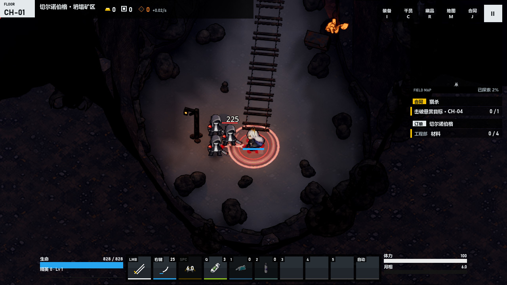

- **即时战斗**：点地面移动，点敌人攻击，技能放在快捷栏。
- **读招**：每个敌人出招前都有前摇动作，精英和 Boss 的范围技会在地上画出警示区，看准了躲开。
- **仇恨**：被打的敌人会一直追你，追丢了才回原位，可以拉怪、风筝。
- **伤害类型**：物理、法术，以及灼燃、寒冷、侵蚀、神经四种元素伤害，敌我都有对应的抗性；元素伤害会在目标身上累积损伤。
- **增益与减益**：加速、减速、眩晕、沉默等，干员和敌人身上都看得到。
- **威胁值**：在一层待得越久威胁越高，会引来巡逻队，敌人越来越强，还会带到下一层。磨蹭有代价。
- **地区计量**：污染、寒冷、血债各自对干员造成影响，要靠药剂、火堆或尽快离开来控制。

### 局内成长

- **藏品**：来自集成战略的藏品，每局重新收集，可以大幅改变打法。
- **药剂**：治疗和各种增益药剂，可以设置自动喝药。
- **行商**：坎诺特随机出现，卖藏品、装备和药剂，也收东西；营地有可露希尔；还有卖地区药剂的游商。
- **事件**：路上的随机遭遇，选择不同，结果不同。
- **局内存档**：随时保存退出，下次从当前层继续。

### 撤离与结算

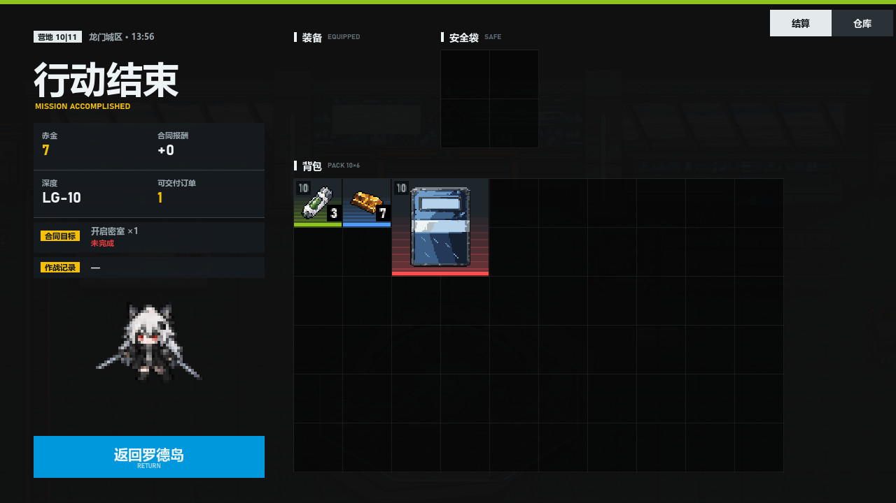

撤离点不是每层都有，营地也只在固定深度出现。撤离后进入结算：带回的物品逐件列出，可以一键入库；完成的合同在这里交付。

---

## 干员

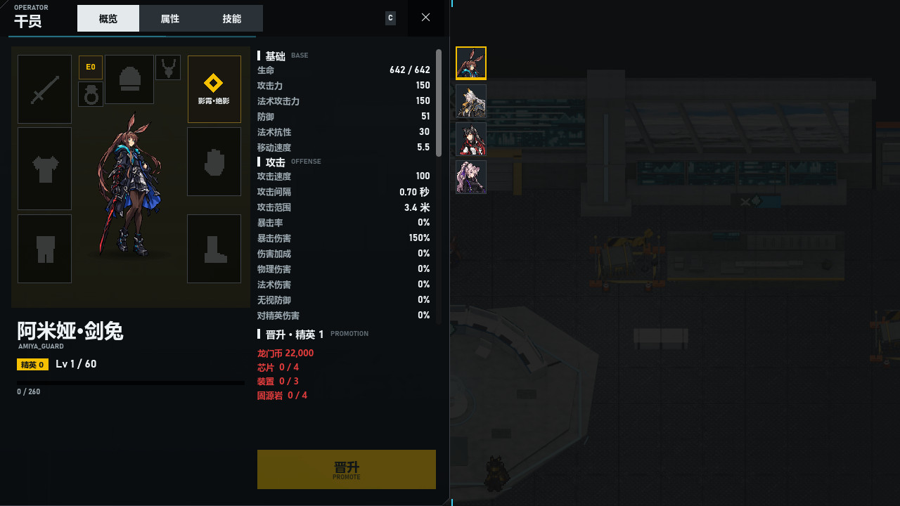

博士随队指挥，玩家操控出战的干员，PRTS 全程播报战况。

### 九名干员

阿米娅、拉普兰德、赫拉格、早露、星熊、林、提丰、寒檀、德克萨斯。

### 获得与培养

- **寻访**：在人事部招募新干员。
- **失散干员**：有的干员在外勤中失散，要顺着踪迹找回来；找回后会开放对应的基地部门。
- **升级与加点**：外勤攒经验，属性点和技能点自由分配，每人一棵技能树。
- **精英化**：消耗材料提升干员，解锁更高阶的武器和技能。
- **独立装备**：每名干员一套装备，换人出战时整套切换。
- **重伤与治疗**：干员倒下后重伤，要在医疗部治好才能再出战，可以先换别人上。
- **完整数值**：干员窗口能看到所有最终属性。

---

## 刷宝

### 掉落

- 敌人、精英、Boss、密室宝箱、兴趣点都会掉东西，越往深处掉得越好。
- 掉落物分装备、PRTS 材料、药剂、收藏品、整理箱、地区特产和违禁品。
- 地上的物品有名牌，品质用颜色区分，可以设置拾取过滤。

### 装备

- 武器、防具、饰品等多个部位，每名干员各穿一套。
- 四个地区各有自己的武器和防具款式：近战、远程、法杖，造型和固有属性都不一样。
- 地区独有词条，只在当地掉落的装备上出现。
- 六档稀有度，从普通到传说。
- 随机前缀，按特效族分类，可以出双前缀，数值有浮动。
- 物理、法术和四种元素伤害，以及对应的抗性。
- 每个 Boss 一套专属装备和套装效果。
- 制式装备：整备台免费领，跟合同绑定，保证不会空手出门。

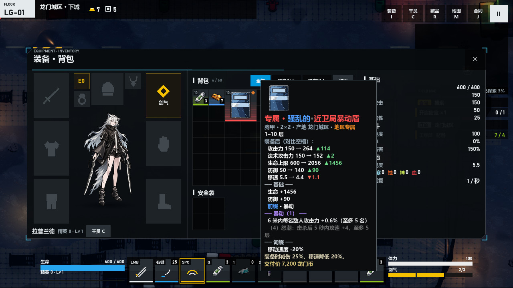

### 背包与仓库

- 背包和仓库都是网格，物品按形状占格，可以旋转。
- 主背包加多页小包，另有一个死了也不丢的安全袋。
- 整理箱可以把同类物品收在一起，能升级。

### 打造

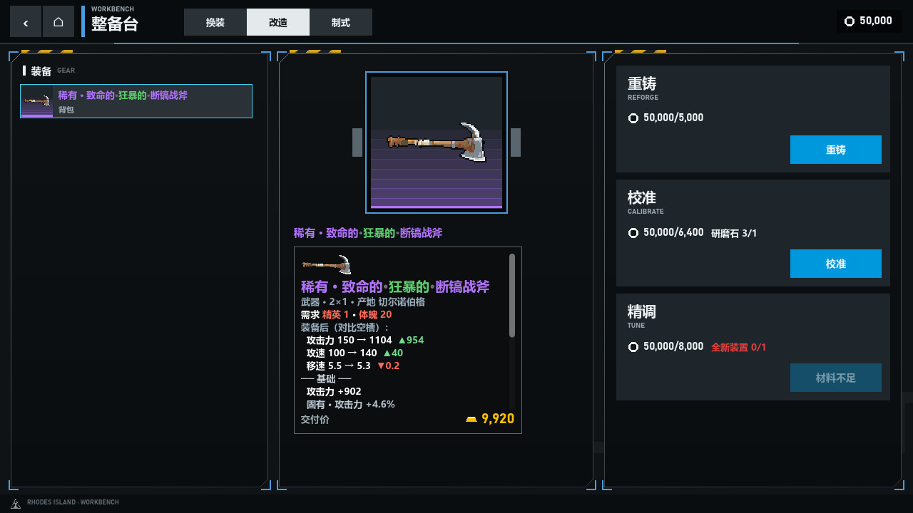

- 整备台：重铸、校准、精调前缀。
- 定向重铸：和龙门商会关系够好才开放。
- 加工站：把材料加工成更高级的材料和成品。
- 科研部：解锁更高阶的前缀和打造选项。

### 风险与保全

- 死在外勤里，背包里的东西会丢。
- 出发前可以投保，没带回来的投保装备之后会由罗德岛小队送回。
- 局内有随机撤离点和营地，什么时候走由玩家决定。

---

## 罗德岛

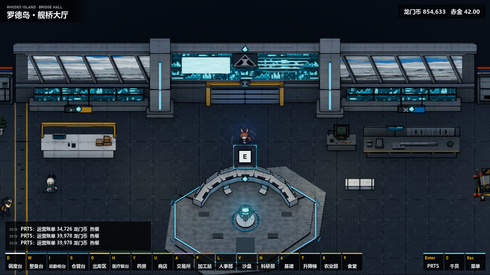

可以走动的基地，有调度台、整备台、仓库、医疗部、药房、商店、加工站、人事部、科研部、基建、沙盘、交易所等站点。

---

## 经济与交易所

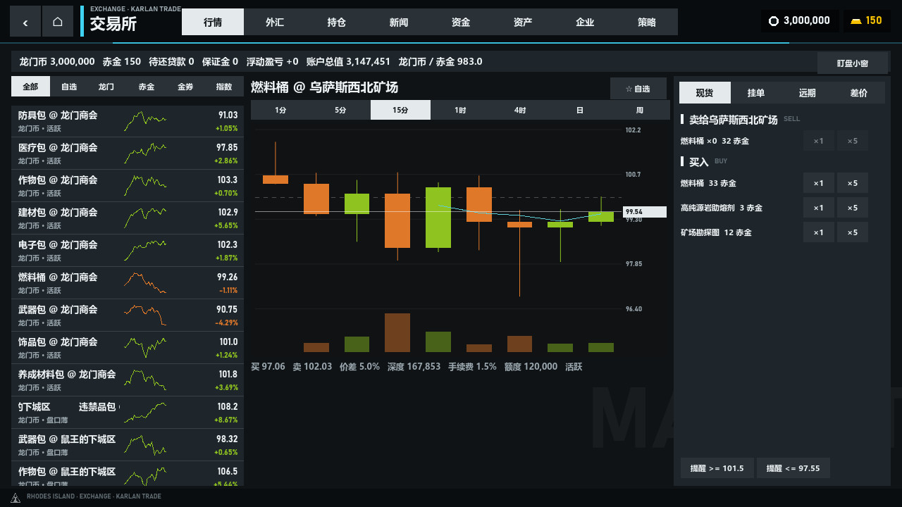

动态模拟经济系统。外勤带回的东西要通过交易所和各家势力变现，罗德岛的日常运转也离不开市场。

### 货币

- 赤金：局内货币，也是交易所的结算货币。
- 龙门币：局外货币，用于建设、科研、寻访和日常开销。
- 地区货币：多个地区各有自己的货币和汇率。

### 九家势力

龙门商会、鼠王的下城区、莱茵生命、喀兰贸易、乌萨斯西北矿场、整合运动残党、萨米林地部族、卡西米尔商业联合会、企鹅物流。

- 每家各有自己收购和出售的货物、营业时间、手续费和性格，有的只在黑市或外勤出现。
- 势力之间有关系和态度，会自己在市场上买卖、借贷，并对事件做出反应。
- 声望等级：从冷漠到崇拜，升级送礼，解锁特供商品、徽记和据点。
- 每家都有对应部门的特供商品。

### 交易

- 现货：按大类交易包买卖物资，包可以拆开取用。
- 挂单、远期交割、差价合约（可做空）。
- 外汇：多个地区货币盘和兑换商。
- 可露希尔代售：在基地和营地卖散货和装备。
- 企鹅物流：跨地区运货。
- 可露希尔贷款。
- 加工部：把散货加工、打包成交易包。

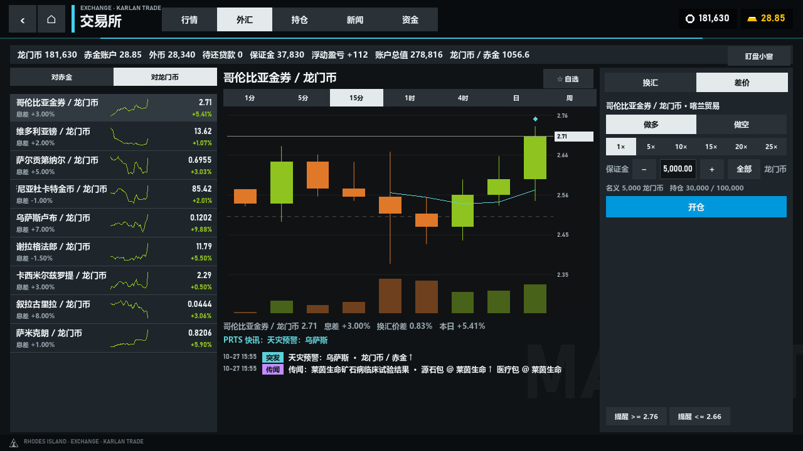

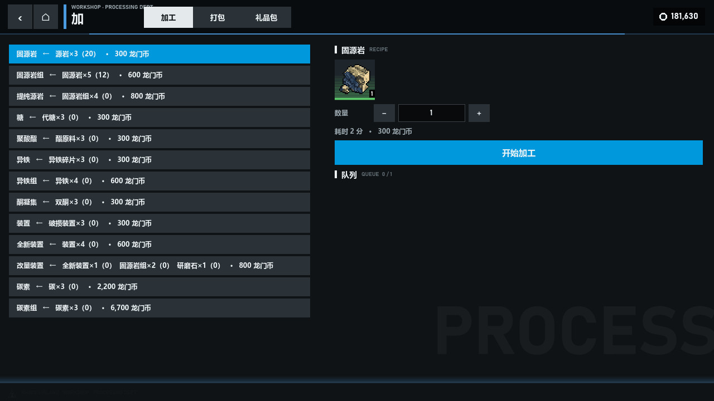

### 行情与新闻

- 实时 K 线，游戏关着的时候市场也在走，读档时补上。
- 新闻分突发、传闻、公告和黑天鹅，事件之间互相关联，传闻会被证实或辟谣。
- 景气周期：企业、货物、信贷、势力和市场情绪一起影响整体景气。
- 信贷池：大家闲置的钱借给需要的人，利率随松紧变化。
- 玩家自己大量抛售也会压低价格。

### 企业与证券

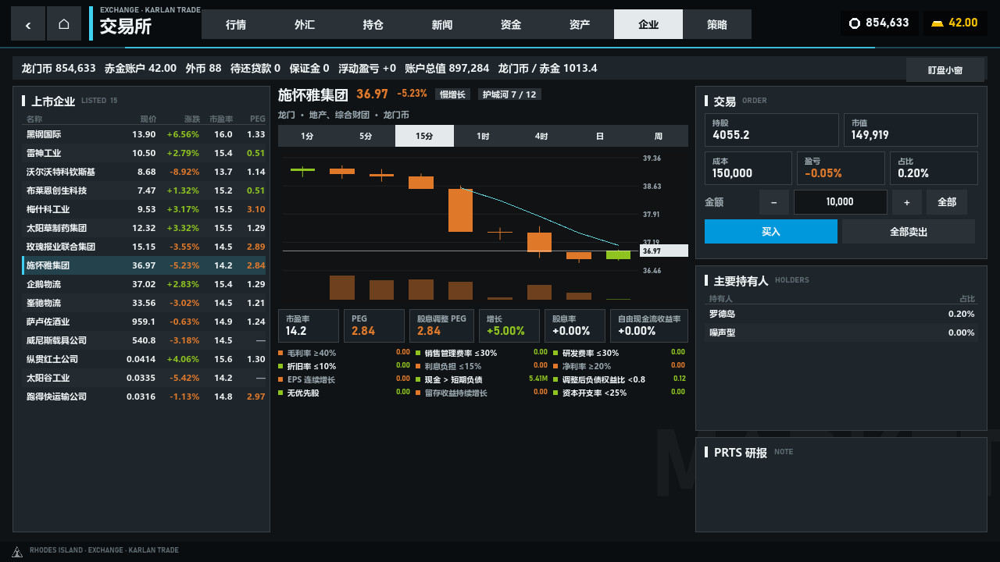

- 上市企业：有生产、季报、分红、回购、增发和重组。
- 股票、主权债和企业债（会违约）、基金、赤金存单。
- 活期和定期存款、授信额度。
- 资产页：净值、持仓、负债一览。

### 自动策略

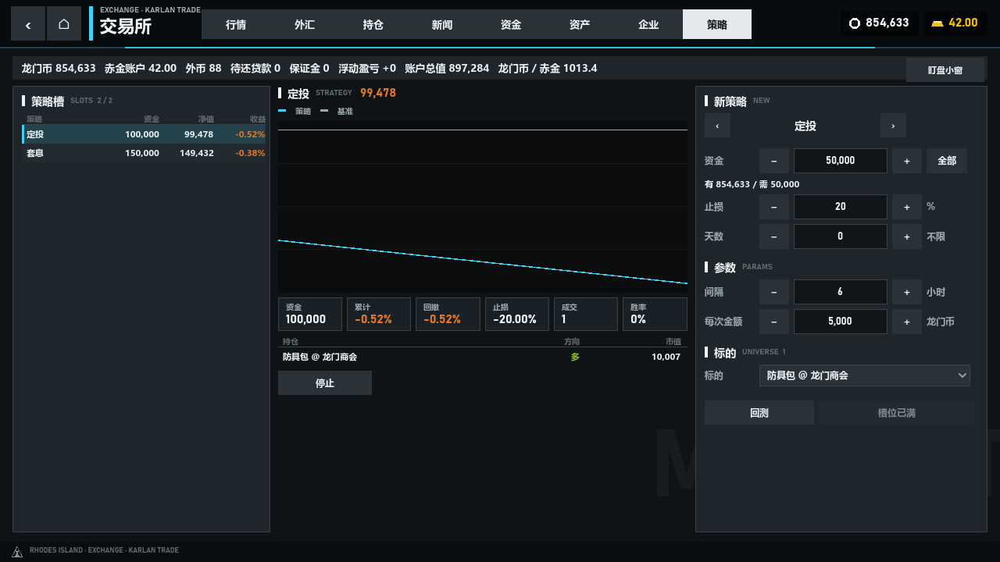

- 多种量化策略模板，用独立资金自动交易。
- 可以调参数、回测历史行情，有止损线。

### 罗德岛运营

- 每天的运营开销：设施消耗材料、干员工资、食堂口粮。
- 燃料储备：航行和运转要用燃料。
- 沙盘航行：大宗订单、运送合同、医疗驻留。

### 游戏外

- 交易终端（待完善）：不开游戏也能看盘、下单。
- 盯盘小窗（待完善）：只看行情，有 Windows 通知。

---

## 主线

基地有一条主线剧情。

---

## 运行

Godot 4.7.2，Forward+，Windows 下用 D3D12。用 Godot 打开 `project.godot`，运行 `game/main.tscn`。

---

## 版权

非商业同人作品。明日方舟、罗德岛、PRTS 以及其中的角色、势力、地区归鹰角网络（Hypergryph）所有。
